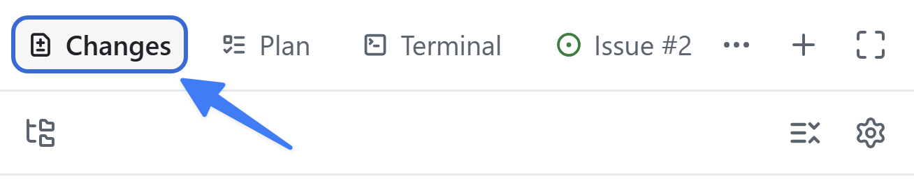

O contexto é essencial ao trabalhar com IA generativa. Se uma tarefa precisa ser realizada de uma maneira específica, disponibilize essas orientações ao Copilot. Os [arquivos de instruções][instruction-files] descrevem não apenas *que* código você quer, mas também *como* ele deve ser estruturado. Agora que você criou a filtragem, vai explorar as instruções usadas pelo Copilot, adicionar um padrão de documentação e aplicá-lo ao código.

Nesta lição, você vai:

- explorar como as instruções do repositório e os arquivos associados a caminhos chegam ao agente;
- atualizar o arquivo de instruções para garantir que os padrões de código sejam seguidos;
- observar o impacto dos arquivos de instruções no código.

## Cenário

Como toda boa empresa de desenvolvimento, a Tailspin Toys tem diretrizes e requisitos para suas práticas de desenvolvimento. Eles incluem:

- Os comentários devem explicar a intenção e as decisões que não são óbvias, em vez de apenas repetir o código.
- As funções exportadas em `db/` e `src/lib/` devem documentar a finalidade, os parâmetros e os valores retornados com TSDoc/JSDoc, incluindo um argumento `db` injetável, quando existir.
- Os componentes Astro reutilizáveis devem documentar seus contratos `Props`, e os comentários devem continuar atualizados quando o código relacionado mudar.
- As orientações existentes de formatação e lint devem ser preservadas.

Com arquivos de instruções, você garantirá que o Copilot tenha as informações necessárias para executar as tarefas de acordo com essas práticas.

## Arquivos de instruções

As instruções personalizadas fornecem contexto e preferências ao Copilot para que ele entenda melhor seu estilo de código e seus requisitos. Esse recurso permite orientar o Copilot para gerar sugestões e trechos de código mais relevantes. Você pode especificar convenções de código, bibliotecas e até os tipos de comentários que prefere. É possível criar instruções para todo o repositório ou para tipos específicos de arquivos, fornecendo contexto adequado à tarefa.

Há dois tipos de arquivos de instruções:

- `.github/copilot-instructions.md`, um único arquivo enviado ao Copilot em **todas** as solicitações feitas para o repositório. Ele deve conter informações sobre o projeto relevantes para a maioria das solicitações enviadas pelo chat ou pela CLI.
- Arquivos `.github/instructions/*.instructions.md`, que podem ser criados para tarefas ou tipos de arquivo específicos. Você pode usá-los para orientar linguagens, como TypeScript ou Astro, ou tarefas, como criar um componente de interface ou um novo conjunto de testes unitários.

> [!NOTE]
> Outros formatos de instruções e o suporte a eles variam de acordo com o ambiente. Consulte a [referência de suporte a instruções personalizadas][custom-instructions-support] antes de depender de um formato específico.

## Explore os arquivos de instruções personalizadas deste projeto

O projeto inicial já inclui um conjunto de arquivos de instruções. Vamos explorá-los antes de fazer alterações para observar seu impacto.

1. Volte à sessão da lição anterior.
2. Se o painel de revisão ainda não estiver visível, abra-o selecionando **Toggle review panel** no canto superior direito.

   

3. Selecione o ícone **+** para **Open in panel** e abrir um novo canvas.
4. Selecione **Files**.
5. Selecione o ícone **Gear** e confirme se **Show hidden files** está marcado.
6. Acesse `.github/copilot-instructions.md`.
7. Explore o arquivo e observe a breve descrição do projeto e seções como **Agent notes**, **Code standards**, **Scripts** e **Repository Structure**. Em **Code standards**, observe as orientações aninhadas sobre **GitHub Actions Workflows**. Elas se aplicam a todas as interações com o Copilot.
8. Acesse a pasta `.github/instructions` e explore os arquivos. Observe as instruções para arquivos Astro, a camada de dados Drizzle, testes e outros tópicos.
9. Abra `.github/instructions/unit-tests.instructions.md`. Observe o campo `applyTo` na parte superior: ele define um padrão glob (relativo à raiz do repositório) que determina os arquivos aos quais as instruções se aplicam. Neste caso, qualquer arquivo de teste TypeScript — por exemplo, um que corresponda a `**/*.test.ts` — corresponderá ao padrão.
10. Observe as instruções específicas para criar testes unitários neste projeto.
11. Por fim, abra `.github/instructions/drizzle.instructions.md` e vá até o final. Observe os links para outros arquivos de instruções, como `unit-tests.instructions.md`, e para arquivos existentes no projeto. Assim, você pode dividir conjuntos de instruções maiores em arquivos menores e reutilizáveis e indicar exemplos que o Copilot deve seguir ao gerar código. Os caminhos são relativos ao arquivo de instruções, não à raiz do repositório.

## Atualize os arquivos de instruções para seguir as orientações da equipe

Os arquivos existentes são um bom começo, mas ainda há algumas lacunas. Vamos modificar o arquivo principal `copilot-instructions.md` para garantir que [comentários TSDoc][tsdoc] sejam adicionados a todos os arquivos TypeScript recém-gerados.

> [!NOTE]
> Como os arquivos de instruções têm grande impacto sobre o código gerado pelo Copilot, confirme se eles fornecem orientações claras. Você pode pedir ao Copilot que crie uma primeira versão e, depois, revisá-la para confirmar se as atualizações atendem aos requisitos. Também pode consultar uma [coleção de arquivos de instruções no Awesome Copilot][awesome-copilot], que serve como ótimo ponto de partida.

1. No mesmo canvas de arquivos, acesse `.github/copilot-instructions.md`.
2. Alterne para a exibição editável do código-fonte selecionando o botão de código (ícone `<>`) na barra de ferramentas do arquivo.
3. Localize o cabeçalho **Code formatting requirements**, que deve estar aproximadamente na metade do arquivo.
4. Adicione o seguinte como último item abaixo desse cabeçalho:

   ```plaintext
   All new TypeScript should contain TSDocs comments for documentation purposes.
   ```

O arquivo será salvo automaticamente e estará pronto para uso.

## Use as orientações atualizadas

Agora que o arquivo de instruções está atualizado, vamos pedir ao Copilot que revise a atualização e faça as alterações necessárias para observar o impacto no código gerado.

> [!NOTE]
> Vamos pedir explicitamente ao Copilot que use o arquivo de instruções porque acabamos de alterá-lo. Ao criar código quando os arquivos de instruções já estão disponíveis, o Copilot os usa automaticamente, sem que seja necessário pedir.

1. Envie um prompt ao Copilot para pedir que use os arquivos de instruções e atualize o código de acordo com os novos requisitos:

   ```plaintext
   We just updated our instructions and code guidance. Can you please update the code you generated to match that guidance?
   ```

2. Selecione **Changes** no canto superior direito para abrir as alterações de código.

   

3. Examine os arquivos TypeScript e observe os novos comentários TSDoc.

## Resumo e próximos passos

Você explorou como o aplicativo obtém contexto dos arquivos de instruções e aplicou um novo padrão ao recurso. Em particular, você:

- explorou o `copilot-instructions.md` do repositório e os arquivos `*.instructions.md` associados a caminhos;
- atualizou o arquivo de instruções para garantir que os padrões de código sejam seguidos;
- observou o impacto dos arquivos de instruções no código gerado.

Em seguida, você vai [personalizar e executar a skill reutilizável `quality-checks`][next-lesson] para garantir a execução consistente do lint e dos testes.

## Recursos

- [Arquivos de instruções para personalizar o GitHub Copilot][instruction-files]
- [Personalizar o aplicativo GitHub Copilot][customize-app]
- [Práticas recomendadas para criar instruções personalizadas][instructions-best-practices]
- [Awesome Copilot — conjunto de arquivos de instruções e outros recursos][awesome-copilot]

[next-lesson]: ../5-agent-skills/
[instruction-files]: https://docs.github.com/copilot/customizing-copilot/about-customizing-github-copilot-chat-responses
[customize-app]: https://docs.github.com/copilot/how-tos/github-copilot-app/customize-github-copilot-app
[instructions-best-practices]: https://docs.github.com/copilot/concepts/prompting/response-customization#writing-effective-custom-instructions
[awesome-copilot]: https://awesome-copilot.github.com/
[custom-instructions-support]: https://docs.github.com/copilot/reference/custom-instructions-support
[tsdoc]: https://tsdoc.org/
[ui-instructions]: https://github.com/github-samples/tailspin-toys/blob/main/.github/instructions/ui.instructions.md
[astro-instructions]: https://github.com/github-samples/tailspin-toys/blob/main/.github/instructions/astro.instructions.md
[managing-issues-prs]: https://docs.github.com/copilot/how-tos/github-copilot-app/managing-issues-and-pull-requests
